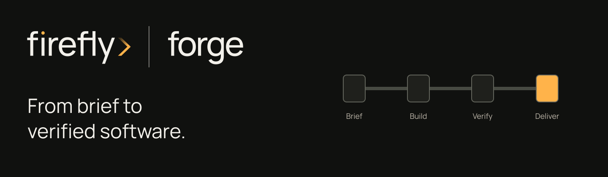

<!-- Copyright (c) 2026 Signature Management Consultants SLU; Author: @ancongui. Modified by Firefly Software Foundation for Firefly Agent Bridge (2026). SPDX-License-Identifier: Apache-2.0. -->

<p align="center"></p>

# Firefly Agent Bridge

Run local coding jobs and resumable workflows through your signed-in Codex or Claude Code CLI. Firefly Agent Bridge connects [firefly forge](https://github.com/fireflyframework/firefly-forge), application SDKs and coding-agent hosts to that worker through scoped HTTP APIs and MCP tools.

The bridge keeps a durable queue, execution attempts, conversation references, workflow checkpoints and activity records. The official CLI owns provider login and native context. Each bridge instance uses one configured worker; its profiles choose models and limits supported by that worker.

[Documentation site](https://fireflyframework.github.io/firefly-agent-bridge/) · [Installation](docs/installation.md) · [Guided console tour](docs/dashboard.md) · [Releases](https://github.com/fireflyframework/firefly-agent-bridge/releases)


The image shows the current console with fixture jobs. It does not establish provider execution. See [verification](docs/verification.md) for separately recorded native, SDK and subscription checks.

## Start on your developer machine

Choose the [native archive](docs/installation.md#install-a-native-archive) for macOS arm64, Linux x64 or Windows x64, or build from source with Node.js 24+, npm and Git. Verify the native archive against its release's `SHA256SUMS` before extracting it, and keep the included runtime and license files together.

Sign in through the official CLI you intend to use:

```sh
codex login
codex login status
```

For Claude Code, use `claude auth login` and `claude auth status`. Provider credentials stay with the official client; a bridge token is a separate credential.

From source:

```sh
git clone https://github.com/fireflyframework/firefly-agent-bridge.git
cd firefly-agent-bridge
npm ci
npm run build
node dist/cli.cjs init --worker codex
node dist/cli.cjs serve
```

The native executable exposes the same commands as `firefly-bridge` (`firefly-bridge.exe` on Windows). Choose `init --worker claude` for a new Claude-backed instance. Initialization preserves existing configuration; change an existing worker through the documented [stop, configure and restart procedure](docs/configuration.md).

Open [http://127.0.0.1:8766](http://127.0.0.1:8766), or run `firefly-bridge panel` to locate the actual address and owner token file. Connect with the owner token, then follow **Providers & setup → Provider → Login → Profile → Tools**. The wizard inspects configuration; official login and worker-file changes happen on the host.

The default state directory is `~/Library/Application Support/Firefly Agent Bridge/` on macOS, Local AppData on Windows, and XDG state on Linux. Protect `owner.token`, `config.json`, `queue.sqlite` and the job workspace. For a custom instance, use the same `--data-dir` on every CLI invocation. The console retains its bridge token only in tab memory; disconnecting clears it.

## Submit, inspect and continue work

| Step                      | What to do                                                                                                   | Guide                                                              |
| ------------------------- | ------------------------------------------------------------------------------------------------------------ | ------------------------------------------------------------------ |
| Create a job              | Enter the task, choose its profile, and review the selected worker and limits before admission.              | [Jobs and conversations](docs/dashboard.md#jobs-and-conversations) |
| Follow execution          | Inspect reported commands, tools, results and file changes. Expand Advanced record for the original payload. | [Activity and audit](docs/audit.md)                                |
| Continue a conversation   | Resume the retained job/session when supported. Inspect an uncertain external effect before repeating it.    | [Recovery and operations](docs/operations.md)                      |
| Repeat an ordered process | Define a validated workflow with existing profiles; each run retains its template snapshot and checkpoints.  | [Workflow templates](docs/workflows.md)                            |

Pause, cancel, resume and retry have different effects. A retry creates another execution attempt; it cannot prove that an earlier command or external write did not happen. Subscription rejection pauses dispatch without switching billing or guessing a reset time.

## Connect a host or application

| Connection             | Supported surface                                                                              | Setup                                                                |
| ---------------------- | ---------------------------------------------------------------------------------------------- | -------------------------------------------------------------------- |
| Codex                  | Bundled plugin/operation skill or local stdio MCP.                                             | [Codex integration](docs/integrations.md#codex-plugin-and-stdio-mcp) |
| Claude Code            | Plugin marketplace, operation/workflow skills and local stdio MCP.                             | [Claude Code plugin](docs/integrations.md#claude-code-plugin)        |
| Claude Desktop         | Matching macOS or Windows MCPB extension; saved bridge configuration still chooses the worker. | [Desktop extension](docs/integrations.md#claude-desktop)             |
| firefly forge and SDKs | OpenAI-compatible Chat Completions with caller-owned functions and a scoped bridge token.      | [forge and SDKs](docs/integrations.md#firefly-forge-and-sdks)        |
| HTTP MCP clients       | Authenticated Streamable HTTP at `/mcp`, retaining the caller's principal and scopes.          | [MCP and API reference](docs/reference.md)                           |
| ChatGPT remote MCP     | Organization-owned reachable HTTPS/OAuth gateway and account-specific host setup.              | [Remote MCP requirements](docs/integrations.md#chatgpt-remote-mcp)   |

Installing a plugin does not change the worker or grant additional native permissions. Host skills guide submission and recovery. [Claude profile-defined specialists](docs/subagents.md) use its native Agent mechanism; Codex uses its own thread protocol and does not translate those definitions. Workers do not automatically inherit a host's personal plugins or skills.

For direct local stdio MCP:

```sh
codex mcp add firefly-agent-bridge -- /absolute/path/to/firefly-bridge mcp
```

Applications need their own scoped tokens. For forge, configure `FORGE_BRIDGE_URL` and load `FORGE_BRIDGE_TOKEN` from private application configuration. A hosted application cannot reach your developer machine through its own loopback address. The bridge does not supply an OAuth server or automatically establish a ChatGPT web connection.

Native agent work uses the Chat Completions endpoint with an explicit execution mode:

```json
{
  "model": "bridge/default",
  "messages": [{ "role": "user", "content": "Write a release checklist" }],
  "bridge": { "execution": "agent", "background": true }
}
```

Send this to `POST /v1/chat/completions` with a bearer header and an idempotency key. The 202 response identifies a durable job; inspect `GET /v1/bridge/jobs/{id}/result` or `/v1/bridge/events` for its outcome. Inference requests disable native actions and return declared function calls for the calling application to execute. [SDK examples](docs/openai-compatible.md) cover structured output, functions and bounded image input with explicit capability verification.

## Configure access and execution

Profiles set model, deadline, output bounds and permissions. `/v1/models` and owner status report the actual configured worker/profile, rather than an account-wide model catalog. HTTP callers cannot choose arbitrary executables, environments or working directories.

Default Codex agent jobs use workspace-write sandboxing with noninteractive approval. Default Claude jobs use acceptEdits with interactive permission prompts denied. Bypass is an explicit owner choice for a trusted host. A job directory does not establish operating-system isolation for every shell action.

Use [provider configuration](docs/configuration.md), [token scopes](docs/tokens.md), [security boundaries](docs/security.md), [operations](docs/operations.md) and [troubleshooting](docs/troubleshooting.md) when configuring a real developer host. Local protocol tests and fixture screenshots do not establish provider access, host extension consent or remote gateway acceptance.

## Local development and testing

Firefly Agent Bridge is intended for local development and testing. It uses your signed-in coding CLI subscription rather than a separately billed model API; subscription quotas still apply. We advise against production use because provider license/usage restrictions, local security boundaries and performance limits may make it unsuitable. Check [OpenAI's terms](https://openai.com/policies/terms-of-use/) or [Anthropic's consumer terms](https://www.anthropic.com/legal/consumer-terms) for your plan.

<a id="development-and-internal-packaging"></a>

## Development and packaging

Version 0.2.13 maintains internal instructions in native Agentic YAML resources. The build verifies and embeds a generated catalog; installed users need only the normal bridge runtime. Maintainers select the separate Agentic compiler environment with `BRIDGE_PROMPT_PYTHON` and `scripts/prompts-requirements.txt`; `BRIDGE_PYTHON` continues to select the pinned SDK client and documentation environment. Use `npm run prompts:render` or `npm run prompts:check` to maintain the catalog. See [prompt maintenance](docs/prompts.md) before changing message framing or continuation instructions.

`npm run check` runs types, lint, formatting, unit/integration tests, Python SDK interoperability, console/browser journeys, build and contract checks, documentation, native packaging and clean MCP smoke checks. Install the Python requirements described in [verification](docs/verification.md) and select that environment with `BRIDGE_PYTHON` before running the full gate. Native packaging uses official Node.js 26.3.0 through `BRIDGE_SEA_NODE`; a source-runtime check alone does not qualify a native archive.

The CI matrix verifies Linux x64, macOS arm64 and Windows x64 separately. Tagged releases publish native archives, macOS/Windows MCPB bundles and checksums after those checks pass. Verify downloaded assets separately. `npm run test:live:codex` and `npm run test:live:codex:images` consume subscription allowance; their private evidence belongs under ignored `work/`.

For documentation, install `docs/requirements.txt`, run `npm run docs:build`, then `npm run docs:test:browser` and `python scripts/check_docs_site.py`. MkDocs writes `work/docs-site`. The main-only GitHub Pages workflow publishes that checked site; pull requests validate without deploying. The [console tour](docs/dashboard.md) explains each screenshot and distinguishes fixture activity from actual execution.

## License and documentation

The software is open source under Apache-2.0. Preserve [LICENSE](LICENSE), [NOTICE](NOTICE) and third-party notices. Firefly marks and separately owned artwork retain the rights described in [Brand ownership](assets/BRAND-NOTICE.md).

[Architecture](docs/architecture.md) · [HTTP API](docs/api.md) · [CLI/MCP reference](docs/reference.md) · [Compatibility](docs/compatibility.md) · [Verification](docs/verification.md) · [Security policy](SECURITY.md)
