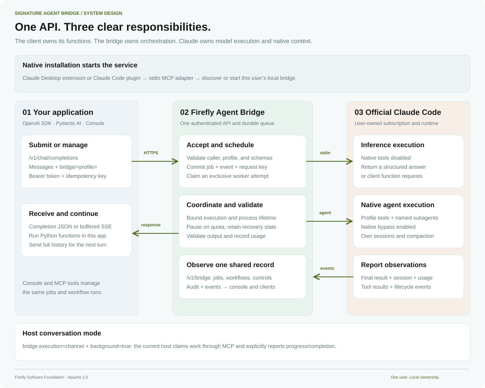
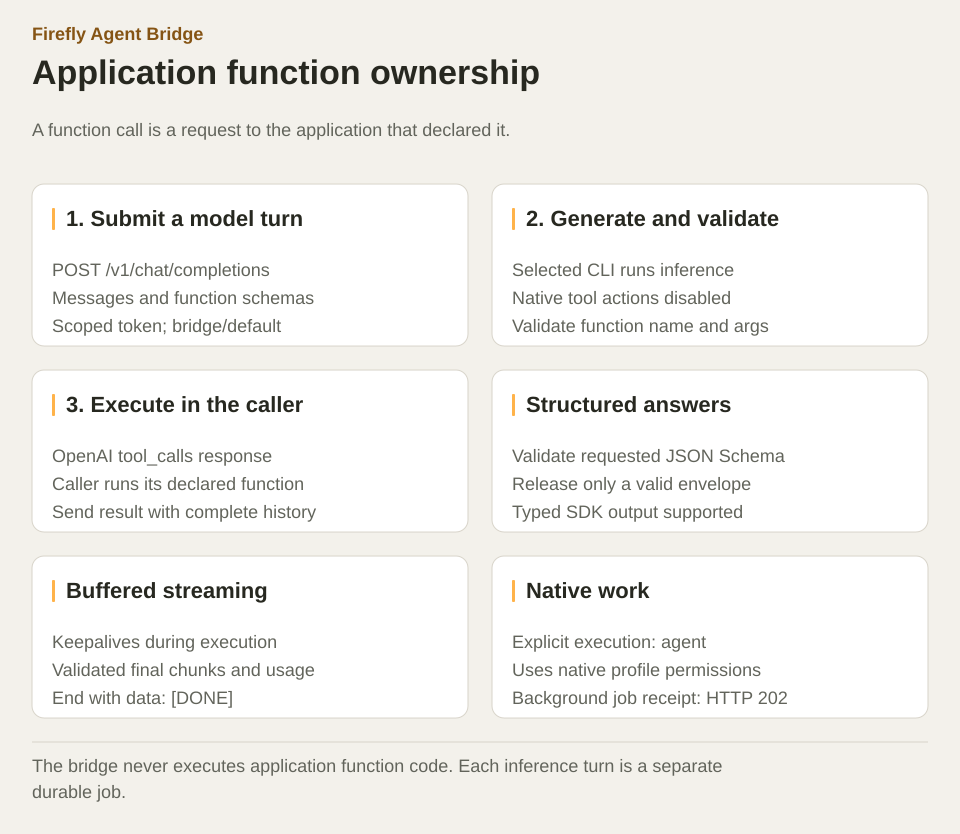
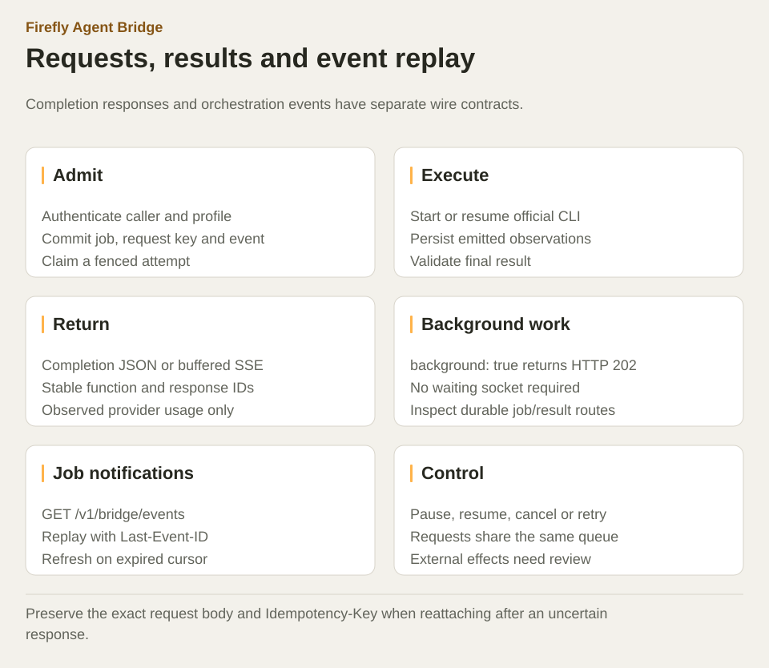
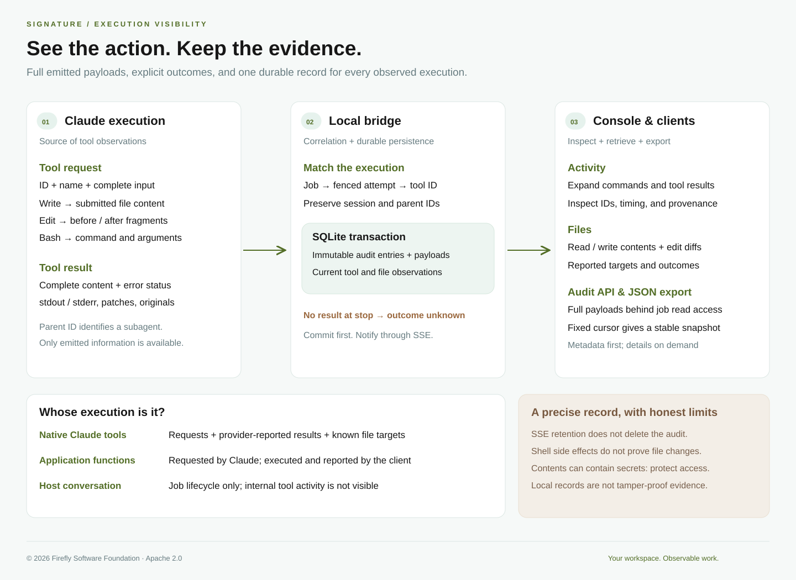

<!-- Copyright (c) 2026 Signature Management Consultants SLU; Author: @ancongui. Modified by Firefly Software Foundation for Firefly Agent Bridge (2026). SPDX-License-Identifier: Apache-2.0. -->

# Architecture

A local service owns the queue, HTTP listener, scheduler, workflows, and audit. Stdio MCP hosts, the console, SDKs, and remote MCP clients use that service. The selected official Codex or Claude Code CLI owns its provider login, native session, model access, and context.

## Request lifecycle

| Stage    | Caller                                                                  | Bridge                                                         | Official CLI                                                 |
| -------- | ----------------------------------------------------------------------- | -------------------------------------------------------------- | ------------------------------------------------------------ |
| Submit   | Send messages, profile alias, bearer token and optional idempotency key | Authorize and validate; commit job and admission event         | Not running yet                                              |
| Claim    | Wait for response or retain background job receipt                      | Claim an exclusive fenced attempt                              | Start or resume the selected worker                          |
| Execute  | Inference caller waits; host conversation claims its own work           | Bound attempt time and output; persist observations            | Produce a structured answer or perform permitted native work |
| Return   | Receive completion JSON, buffered SSE, or terminal job result           | Validate envelope, function names, arguments and output schema | Report result, native session and observed usage             |
| Continue | Inference sends full history; native job sends a follow-up              | New inference job or continuation of existing native job       | Resume the job's saved native session when available         |

`bridge.execution` selects inference, native agent, or host conversation work. The `/v1/bridge` routes provide durable job state, execution controls, workflow checkpoints, scoped access, and replayable events. `/mcp` is a stateless Streamable HTTP view of the same management tools; it preserves its caller's authorization.

## One state owner

MCP adapters discover or start a shared local service. A renewable filesystem lock gives one process ownership of the database and worker processes. Service identity and protocol checks prevent a different listener from being accepted as the bridge. A port collision is detected before crash recovery changes attempts.

This lets several hosts share one queue while configuration and history remain outside plugin cache directories. A host lease keeps managed services available. Plain `serve` stays available independently of host lifecycle.

## Identities and transactions

| Identity             | Purpose                                   | Lifetime                                            |
| -------------------- | ----------------------------------------- | --------------------------------------------------- |
| Principal            | Application ownership and scopes          | Until token revocation or replacement               |
| Job ID               | Durable work and conversation             | Retained in local state                             |
| Attempt ID and fence | Authority to finish one exclusive attempt | Ends when the attempt finishes or ownership is lost |
| Native session ID    | Coding-agent context and continuation     | Managed by the official CLI                         |

SQLite uses WAL, foreign keys, prepared statements, full synchronous commits, and immediate transactions. Job transitions, admission keys, and event records commit together. A fence rejects stale completion of a newer attempt.

An idempotency key belongs to a principal, operation, and exact request body. Repeating that request returns its existing resource; changing the body under the same key fails with a conflict. A resume continues an available native session. Retry starts a new session and retains the job's history and workspace; it does not roll back prior effects.

## Tool authority

Inference disables native actions and returns requests for declared application functions. The caller executes those functions and sends their results in its next model turn. Structured validation prevents an undeclared function name from becoming an accepted call. The bridge does not execute function code.

Native Codex jobs use its workspace sandbox by default. Native Claude jobs use acceptEdits and the profile tool list. Claude profile-defined agents and native turn controls do not translate to Codex. Explicit bypass is a trusted-host owner choice. A job directory organizes files; the operating system and worker permission policy determine access.

## Worker and process ownership

Prompts go to the owned CLI over stdin without a shell. Worker setup rejects alternate billing environment settings and preserves official subscription authentication. Codex ignores personal configuration while applying deliberate bridge profile options. Claude suppresses host customizations; arbitrary host plugins and skills are not automatically inherited.

The bridge observes the provider's structured protocol. It retains session IDs and reported compaction boundaries without rewriting provider transcripts or inventing replacement summaries. Missing or unavailable sessions remain explicit errors.

An owned POSIX process group, or Windows process tree, supports cancellation and shutdown. Graceful termination is followed by bounded escalation. Descendants are reconciled even if the leader exits first. Host conversation jobs have a different boundary: the bridge requests a stop and waits for an explicit claim receipt acknowledgment because it does not own that host process.

## Streaming and retention

Chat Completions sends keepalives while work runs, then releases validated final chunks and optional observed usage. It is buffered completion streaming. Job notifications use a separate durable SSE sequence with replay cursors.

Synchronous disconnects and deadlines cancel work when the last waiter leaves. Background jobs remain admitted after a disconnected submitter. Operator and quota pauses retain state for explicit recovery. A reported future reset can permit bounded automatic continuation; an unknown reset stays paused.

The service retains approximately 10,000 recent notification IDs. Expired cursors require a state refresh, preventing silent replay gaps. Jobs and full audit remain durable beyond that event window.

## Audit and workflows

Native observations commit complete emitted tool payloads and correlation metadata before publishing lightweight tool notifications. A current projection supplies outcomes and reported file targets; immutable entries support a fixed-cursor export. Missing results remain unknown. Client function requests and reports retain caller provenance rather than being classified as native actions.

A workflow snapshots its template and inputs. A successful current job creates its next sequential step. Failed steps require an explicit retry; an operator pause blocks advancement. Editing a reusable template changes future runs and preserves existing snapshots.

External effects are outside database atomicity. A command can write a file or call a remote service before its result is lost. Crash recovery marks lost attempts interrupted and retains their evidence; the operator reconciles effects before retrying.
