<!-- Copyright (c) 2026 Signature Management Consultants SLU; Author: @ancongui. Modified by Firefly Software Foundation for Firefly Agent Bridge (2026). SPDX-License-Identifier: Apache-2.0. -->

# Management console tour

[README](../README.md) · [Install](installation.md) · [Operations](operations.md)

Open the local console URL returned by `bridge_panel` and authenticate with a bridge token. It submits through `/v1/chat/completions` and uses the same `/v1/bridge` management and notification extensions as other applications.

Select any screenshot to open its full capture. Images follow the page's light or dark appearance.

The screenshots show Bridge 0.2.18 running in an isolated local fixture service at the configured desktop and mobile sizes. Jobs, tool observations, workflow results and provider states use deterministic fixtures. Sign-in, quota reports and dispatch appear separately; a signed-in or enabled state does not establish remaining quota or context capacity. The controlled scenes do not measure a real subscription. Historical checks with authenticated official CLIs remain in [verification](verification.md).

## Connect

At **Connect**, choose a destination from the sidebar or phone menu. The console opens that destination after authentication. Locked destinations show the access requirement and withhold private job and service state.

Paste an owner or application token into **Bridge token**. It remains in tab memory and is cleared from the form after connection. Reloading or disconnecting clears the session. Expired or revoked access returns to the connection gate and clears loaded private details.

<figure class="bridge-shot bridge-shot--phone" markdown="1">

<figcaption>Connection gate before authentication. Choose your destination, enter a bridge token, then select Connect. Private job details appear only after access is accepted.</figcaption>
</figure>

## Jobs and conversations

Select a row to inspect messages, attempts, session continuity, and reported child tasks. Follow-ups remain associated with the same job. A message submitted while work is running is queued until the current attempt completes.

<figure class="bridge-shot" markdown="1">

<figcaption>Jobs overview with a selected fixture conversation. Use the queue to choose work, then inspect the conversation and attempt state before continuing it.</figcaption>
</figure>

**New job** opens three steps: Task, Execution and Review. Describe the work, choose an existing profile and execution mode, then review the actual worker, native model, permissions and limits. Back preserves your choices. Queue job appears only on the review step.

Native coding jobs use the official CLI's configured capabilities. Text completions disable native actions; application callers execute declared functions. Host conversations wait for a connected host to claim the work. A failed or unknown admission keeps the request key when you queue unchanged content again.

Follow the three new-job steps

<figure class="bridge-shot" markdown="1">

<figcaption>Task: enter the instructions and choose a task title. Continue to Execution to inspect how the work will run.</figcaption>
</figure>

<figure class="bridge-shot" markdown="1">

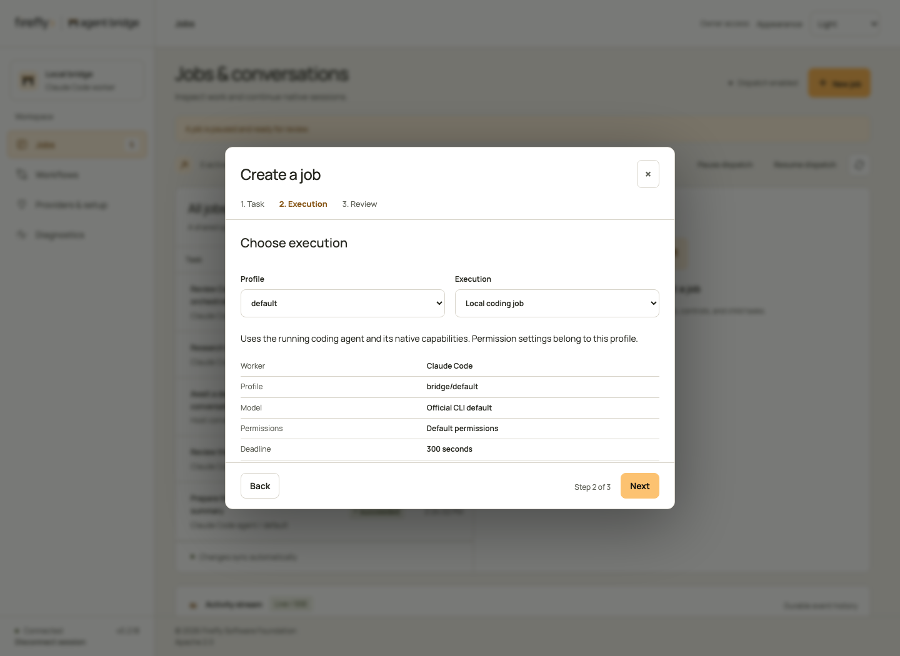

<figcaption>Execution: choose an existing profile and execution mode. Continue to Review before admitting work.</figcaption>
</figure>

<figure class="bridge-shot" markdown="1">

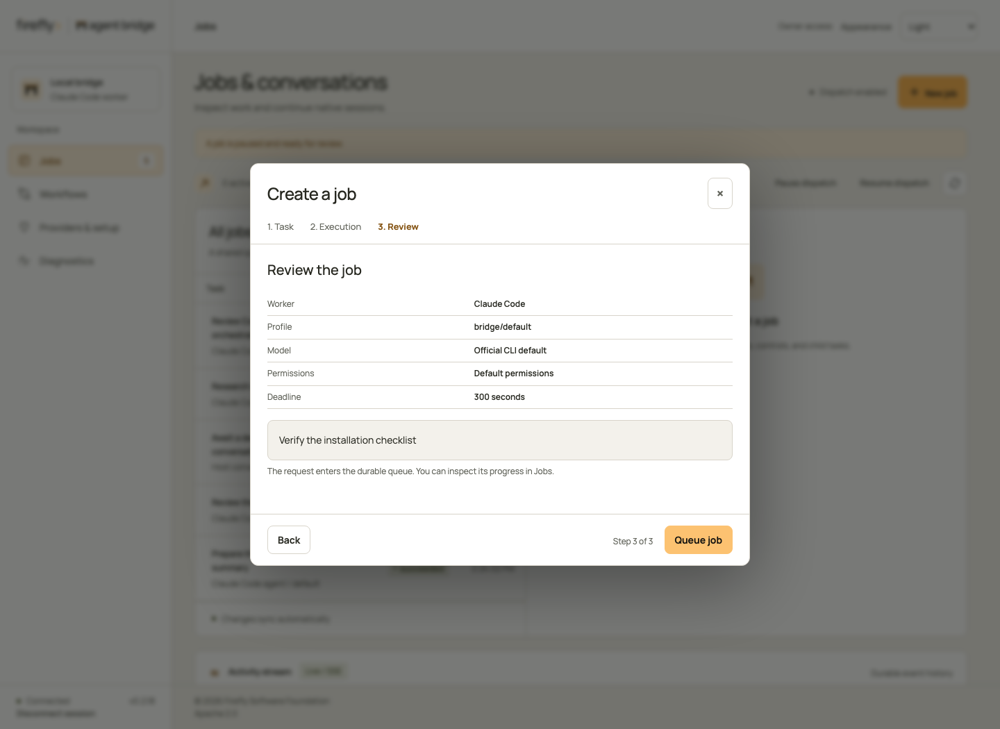

<figcaption>Review: inspect the effective worker, native model and limits. Queue job admits this request; Back returns to your choices.</figcaption>
</figure>

<figure class="bridge-shot bridge-shot--phone" markdown="1">

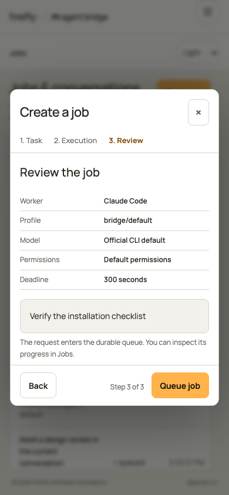

<figcaption>Phone review uses the same admission step. The visible Queue job action submits work only when you choose it.</figcaption>
</figure>

Pause, resume, cancel, and retry follow the job state and your token scopes. Image jobs require a fresh explicit request after interruption; their view does not offer in-place resume or retry. Retry starts a new session and can repeat prior effects; resume continues a saved session when available.

## Tool activity, files, and audit

Each job has **Conversation**, **Activity**, and **Files** tabs. Activity shows recorded commands, labeled result fields and bounded stdout/stderr previews. Copy includes the full recorded output. Files shows known targets, submitted or returned content, and available replacement fragments. Expand **Advanced record** for the original payload and correlation fields.

<figure class="bridge-shot" markdown="1">

<figcaption>Activity detail after expanding a Bash observation. Read the recorded command and result before deciding whether to resume or retry. This view is scrolled to the tool card; select Conversation to return to the job context.</figcaption>
</figure>

The TypeScript fixture shows syntax colors and line gutters for submitted replacement fragments, followed by a provider-reported patch. Fragment gutters start at 1; they do not imply positions in the file. The patch columns use its supplied old and new line offsets.

<figure class="bridge-shot" markdown="1">

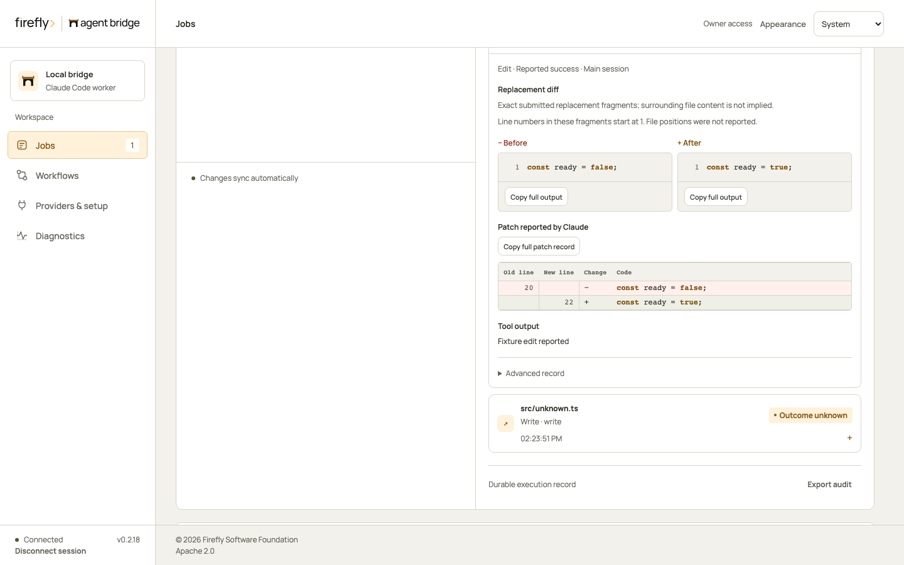

<figcaption>Files detail scrolled to an Edit observation. The before/after blocks are submitted fragments, numbered from 1. The reported patch beneath them uses the provider's old and new offsets; inspect the workspace to establish its current contents.</figcaption>
</figure>

The audit log retains tool and lifecycle observations across service restarts and SSE retention. **Export audit** downloads a consistent JSON snapshot, including full payloads. Failed or interrupted actions remain clearly labeled; the console does not claim to observe every indirect filesystem effect. See [audit coverage, access, and export](audit.md).

Inspect activity and file details on a phone

<figure class="bridge-shot bridge-shot--phone" markdown="1">

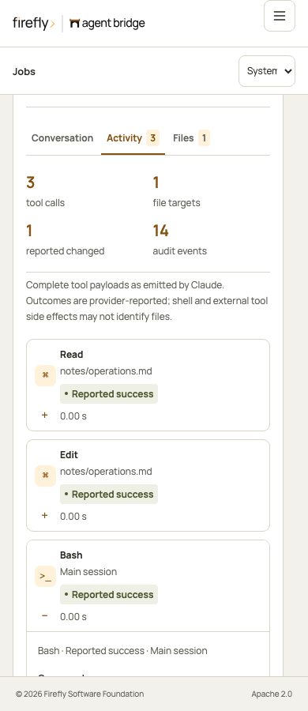

<figcaption>Activity is scrolled to the command card. Expand an observation to read its result; Copy retains the full recorded output.</figcaption>
</figure>

<figure class="bridge-shot bridge-shot--phone" markdown="1">

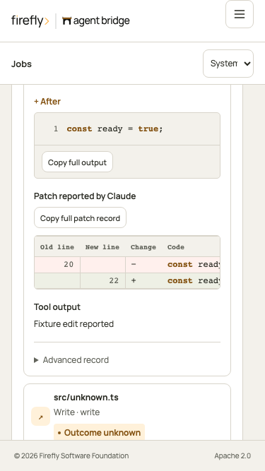

<figcaption>Files is scrolled to the same TypeScript observation. The narrow layout keeps fragment labels and patch offsets with the code.</figcaption>
</figure>

<figure class="bridge-shot" markdown="1">

<figcaption>The Files overview groups known targets. Select an action to inspect its submitted or returned content, then use Advanced record for the original payload.</figcaption>
</figure>

## Chat Completions

SDK requests and console-created completions appear in the same queue. Select one to inspect its submitted message history, validated answer or client function requests, observed token usage, and execution attempts. The inference view hides native follow-up controls because the calling application supplies complete history for its next model turn.

<figure class="bridge-shot" markdown="1">

<figcaption>Completion detail for a fixture request. Inspect the submitted messages and validated result, then return to your application to send its next model turn.</figcaption>
</figure>

Inspect a completion on a phone

<figure class="bridge-shot bridge-shot--phone" markdown="1">

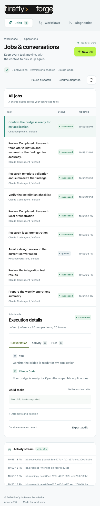

<figcaption>Select a completion from Jobs to open this detail view. Observed usage appears only when the provider reports it.</figcaption>
</figure>

## Workflows

Choose a configured template, fill its named inputs, and start a run. JSON is available only under Advanced input when you explicitly select Use JSON values. Each run shows its current state and links to the jobs created for its steps. **Open step** switches directly to that job's conversation.

<figure class="bridge-shot" markdown="1">

<figcaption>Workflows overview with a configured template and fixture runs. Supply the named inputs and select Start workflow. Open a run's step to inspect the job that performed it.</figcaption>
</figure>

A failed or unknown admission retains its request key when you start again with unchanged inputs. It returns the existing run instead of repeating admitted work.

A workflow pause blocks the next step and requests a pause of its current job. Resuming the workflow clears that barrier. A failed step can be retried from its job view after reviewing its effects.

## Reusable template editor

Use **New template** to define inputs, ordered steps, instructions, and execution profiles. **Edit** updates future runs; existing runs keep their original definition. The form checks references before saving. See [template authoring](workflows.md) for valid use cases and rules.

<figure class="bridge-shot" markdown="1">

<figcaption>Template editor before saving. Declare the inputs, add ordered steps and choose their profiles. Save template validates these references and makes the definition available to future runs.</figcaption>
</figure>

Inspect later steps and the phone editor

<figure class="bridge-shot" markdown="1">

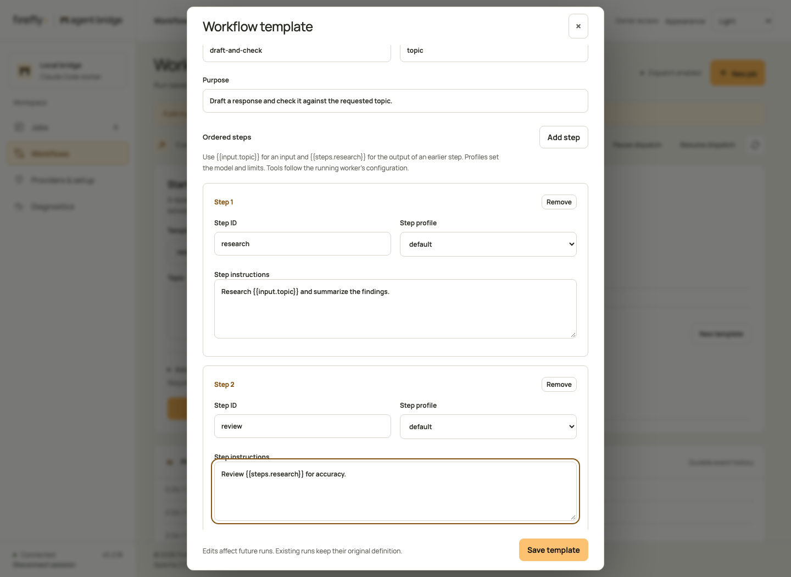

<figcaption>The same dialog scrolled to later steps. Review each prompt and profile before using Save template; existing runs keep their saved definition.</figcaption>
</figure>

<figure class="bridge-shot bridge-shot--phone" markdown="1">

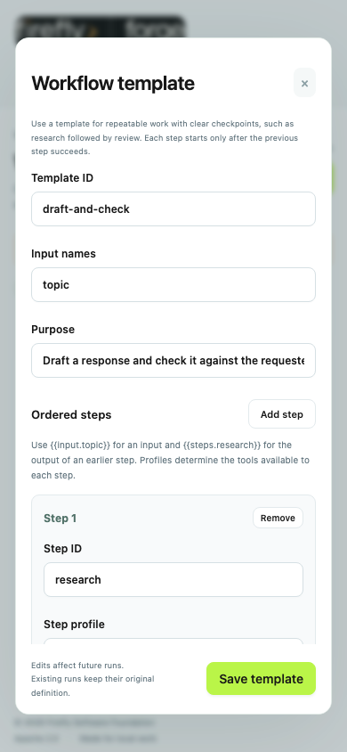

<figcaption>Phone editor at the top of the form. Scroll within the dialog to reach the ordered steps and save action.</figcaption>
</figure>

<figure class="bridge-shot bridge-shot--phone" markdown="1">

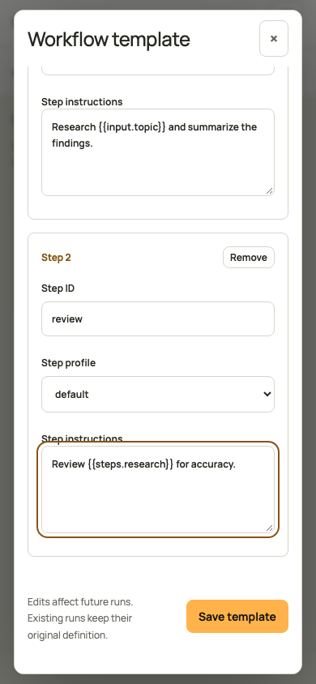

<figcaption>Phone editor after natural scrolling. The visible action belongs to the dialog; it does not cover the fields.</figcaption>
</figure>

## Diagnostics and application access

Service health explains login readiness, dispatch state, active jobs, connected hosts, profiles, OpenAI base URL, model aliases, and the workspace. Expand **Connection and execution details** for the full status payload. Readiness combines official CLI login checks and the dispatch gate. A paused bridge can require attention while the provider remains signed in. Readiness does not establish that every configured model can complete a job.

**View activity** expands the recent event list. **Hide activity** returns to its compact view. These controls change only the display; they do not request new work or repeat an execution. Use the job's audit export when you need its complete durable record.

Create a separate token for each trusted application. Choose Jobs and conversations, Read-only inspection, or Jobs and workflows. New tokens start masked; Show and Copy token are explicit actions. Revocation immediately invalidates requests and active event streams. Read-only access hides submission, continuation, administration and image-probe actions.

<figure class="bridge-shot" markdown="1">

<figcaption>Diagnostics overview with fixture service status and client access controls. Read readiness before creating work. Create a separate scoped token for each trusted application.</figcaption>
</figure>

Inspect Service and Application access on a phone

<figure class="bridge-shot bridge-shot--phone" markdown="1">

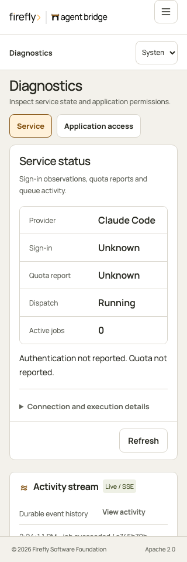

<figcaption>Service tab: inspect the worker, dispatch state and profiles. A signed-in provider can still require attention while dispatch is paused.</figcaption>
</figure>

<figure class="bridge-shot bridge-shot--phone" markdown="1">

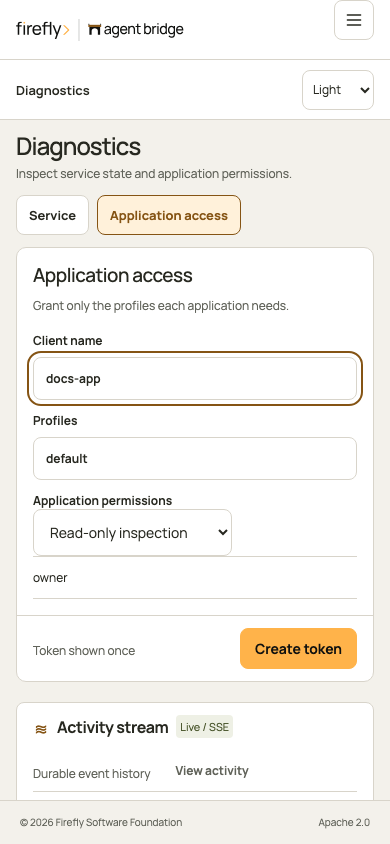

<figcaption>Application access tab, scrolled to the complete token form and Create token action. Choose the application's access before creating its token; Show and Copy are deliberate actions.</figcaption>
</figure>

## Responsive navigation

Phones use a 60-pixel brand row and a 60-pixel context row. **Menu** opens a native modal with full navigation rows. Escape returns focus to Menu; selecting a destination closes it and focuses the heading. Resizing to desktop restores the sidebar and closes the dialog.

At narrower widths, select a job to open its details. **Back to jobs** returns to the queue and stays there during polling. On phones and short windows, the conversation scrolls with the page so you can reach the latest response and continuation form.

Provider setup and Diagnostics use the page scroller, so short screens retain complete fields and readable status. Their action rows follow the content and never cover it. Diagnostics uses Service and Application access tabs on phones. **Actions ↓** appears in the context bar when setup or workflow controls are below the visible content, including on short desktop windows. It scrolls to those controls and focuses them without advancing or submitting. Scroll normally to inspect the intervening fields; the global footer remains in its own row. Desktop uses an aligned 64-pixel status and legal footer; the phone footer occupies a separate 44-pixel row with safe-area padding.

Navigate and reach actions on a phone

<figure class="bridge-shot bridge-shot--phone" markdown="1">

<figcaption>Jobs detail after selecting a queue row. Back to jobs returns to the queue; polling preserves that choice.</figcaption>
</figure>

<figure class="bridge-shot bridge-shot--phone" markdown="1">

<figcaption>Workflows on a phone. Select a template and supply its inputs before starting a run.</figcaption>
</figure>

<figure class="bridge-shot bridge-shot--phone" markdown="1">

<figcaption>Short-screen setup with Actions in the context row. Select it to reach the next control; it scrolls and focuses without advancing the wizard.</figcaption>
</figure>

<figure class="bridge-shot bridge-shot--phone" markdown="1">

<figcaption>Short-screen workflow input view. Actions takes you to the controls below the fold without starting a run.</figcaption>
</figure>

[Tablet jobs](../assets/screenshots/jobs-tablet.png) · [Tablet workflows](../assets/screenshots/workflows-tablet.png) · [Mobile diagnostics](../assets/screenshots/diagnostics-mobile.png)

## Live activity

The activity stream receives authenticated SSE events and reconnects with the last event ID. When retention has removed older events, it refreshes current job state before reconnecting. Tokens stay in tab memory and are never placed in a URL or browser local storage.

## Appearance and provider setup

Appearance follows the system by default. Choose Light or Dark to save an explicit preference on this browser. The console stores only that preference; reloading clears authentication. The fixed 76-pixel header, 248-pixel desktop rail, Manrope typography, and amber controls match the Firefly developer suite. Mobile navigation preserves access to every view.

Providers & setup guides you through four focused steps:

1. **Provider:** choose a Codex or Claude Code setup guide. The current running worker stays visible; selecting another guide does not change it.
2. **Login:** copy the official login command, run it on the bridge host, then refresh the running worker's readiness. Provider credentials are never entered in this form.
3. **Profile:** choose an existing profile and inspect its effective model, permissions, timeout and output bounds. Image input has a separate verification status. An owner can run one explicit image-only check and inspect its durable job; unverified or failed checks do not block ordinary text jobs.
4. **Tools:** select your application and follow its connection instructions. Codex and Claude plugins use the local stdio adapter. HTTP applications use a scoped bearer token. ChatGPT requires a reachable HTTPS gateway and authentication supported by its workspace; this console does not establish that connection.

The wizard keeps your selected profile when you move back between steps. Earlier visited steps remain accessible. **Start a job** opens the normal job dialog with that profile; it does not submit work automatically.

<figure class="bridge-shot" markdown="1">

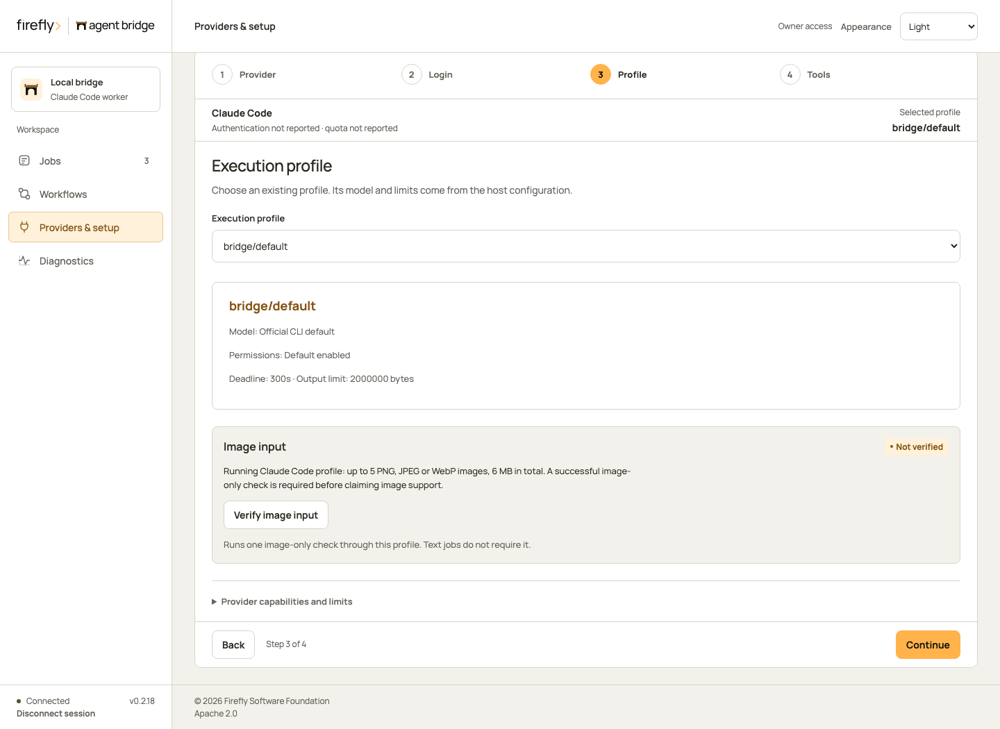

<figcaption>Profile step with the selected worker and effective limits. Read these values before opening New job. Fixture readiness in this illustration is not proof of a real provider login.</figcaption>
</figure>

Follow provider setup on desktop

<figure class="bridge-shot" markdown="1">

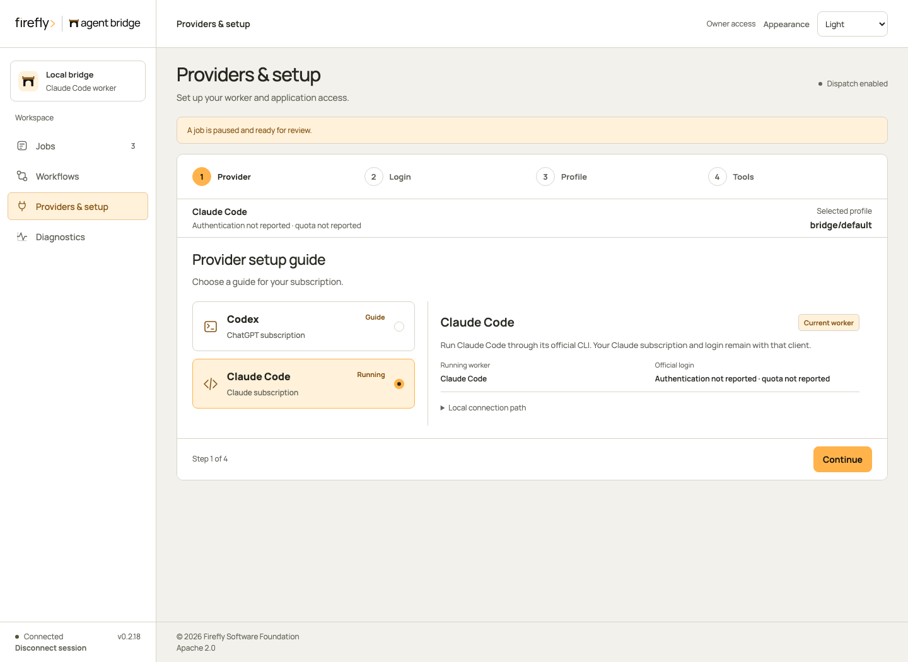

<figcaption>Provider: choose the official CLI guide. Selecting a guide leaves the running worker unchanged.</figcaption>
</figure>

<figure class="bridge-shot" markdown="1">

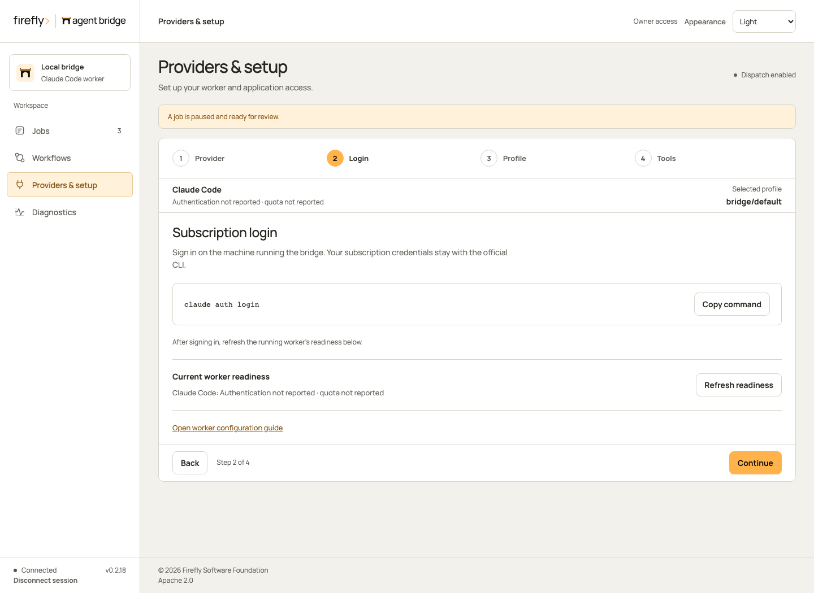

<figcaption>Login: copy the official command and run it on the bridge host. Refresh readiness after completing that host login.</figcaption>
</figure>

<figure class="bridge-shot" markdown="1">

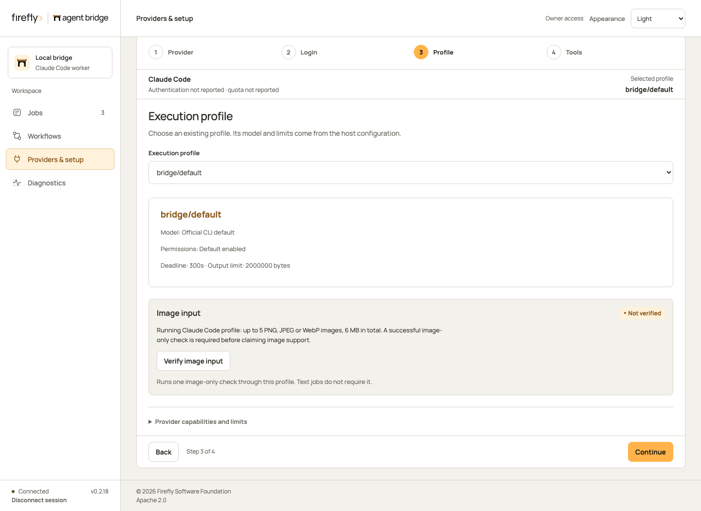

<figcaption>Profile: inspect the saved model, permissions and bounds. Start a job opens the job dialog with this profile.</figcaption>
</figure>

<figure class="bridge-shot" markdown="1">

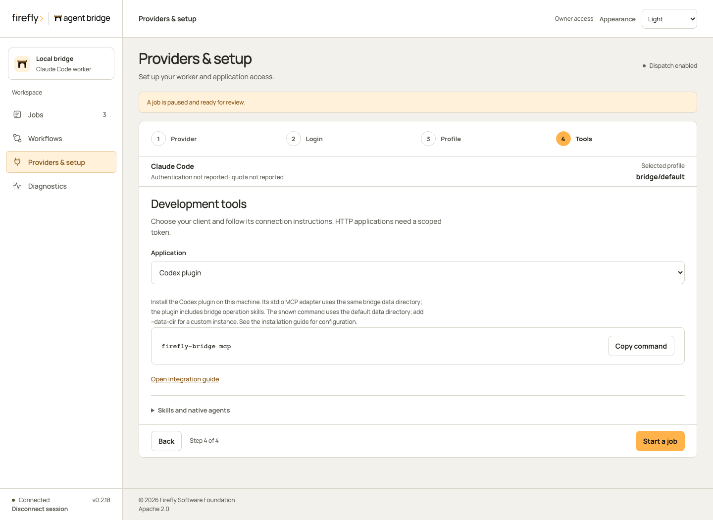

<figcaption>Tools: follow the instructions for your host or HTTP application. This fixture does not establish a ChatGPT gateway connection.</figcaption>
</figure>

Follow provider setup on a phone

<figure class="bridge-shot bridge-shot--phone" markdown="1">

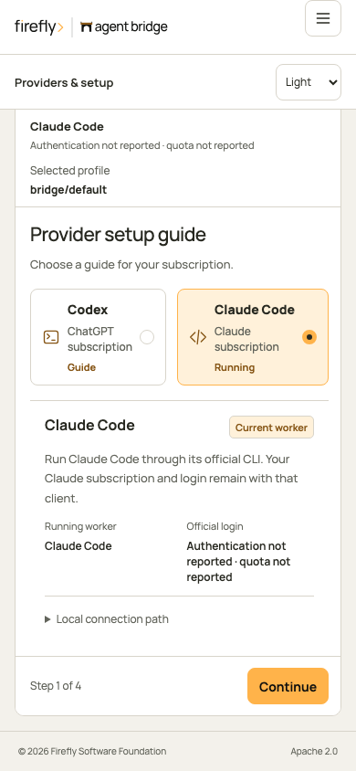

<figcaption>Provider: choose the guide, then use Continue to login.</figcaption>
</figure>

<figure class="bridge-shot bridge-shot--phone" markdown="1">

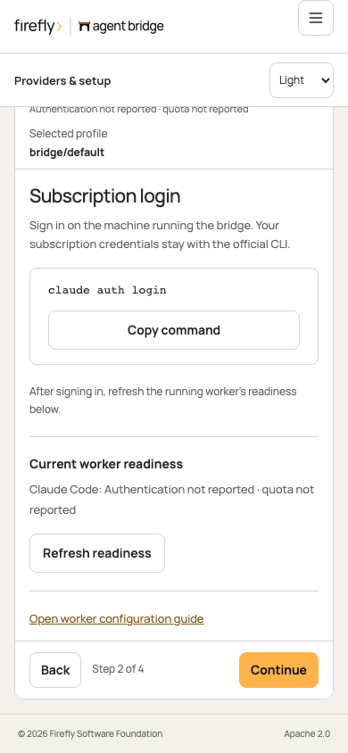

<figcaption>Login: perform the official login on the host, then refresh readiness.</figcaption>
</figure>

<figure class="bridge-shot bridge-shot--phone" markdown="1">

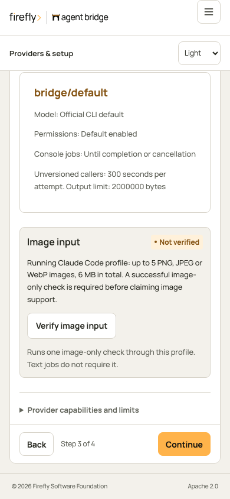

<figcaption>Profile: check effective settings before continuing to Tools.</figcaption>
</figure>

<figure class="bridge-shot bridge-shot--phone" markdown="1">

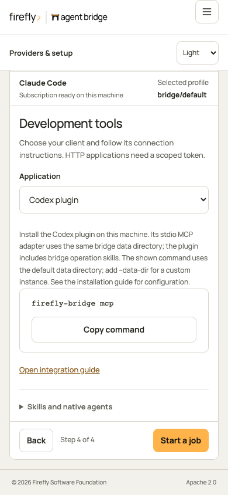

<figcaption>Tools: choose an application and follow its connection instructions. Back preserves the selected profile.</figcaption>
</figure>

Change worker and profile configuration in the saved file while stopped, restart, then check the effective settings here. The console does not accept provider credentials or rewrite executable paths. Claude tool and agent definitions apply to Claude execution; they do not imply restrictions on Codex.
