<!-- Copyright (c) 2026 Signature Management Consultants SLU; Author: @ancongui. Modified by Firefly Software Foundation for Firefly Agent Bridge (2026). SPDX-License-Identifier: Apache-2.0. -->

# Management console tour

[README](../README.md) · [Install](installation.md) · [Operations](operations.md)

The console is served by the local bridge. Open the URL returned by `bridge_panel` and authenticate with a bridge token. It submits through `/v1/chat/completions` and uses the same `/v1/bridge` management and notification extensions as other applications.

The screenshots show the running console. Job, workflow and tool examples use deterministic fixtures. Provider and Diagnostics views use an isolated local bridge with an authenticated official Codex CLI. Screenshots demonstrate the interface; separate execution evidence is described in [verification](verification.md).

## Connect

The initial heading is **Connect**. Choose a destination from the sidebar or phone menu to see where the console will continue after authentication. Locked destinations explain that access is required; they do not claim to show private job or service state.

Paste an owner or application token into **Bridge token**. It remains in tab memory and is cleared from the form after connection. Reloading or disconnecting clears the session. Expired or revoked access returns to the connection gate and clears loaded private details.

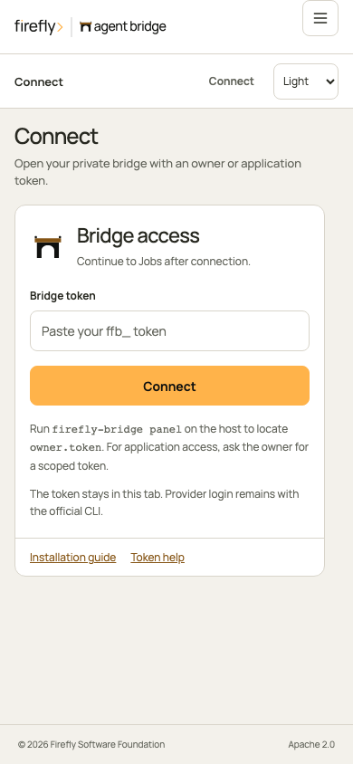

## Jobs and conversations

Select a row to inspect messages, attempts, session continuity, and reported child tasks. Follow-ups remain associated with the same job. A message submitted while work is running is queued until the current attempt completes.

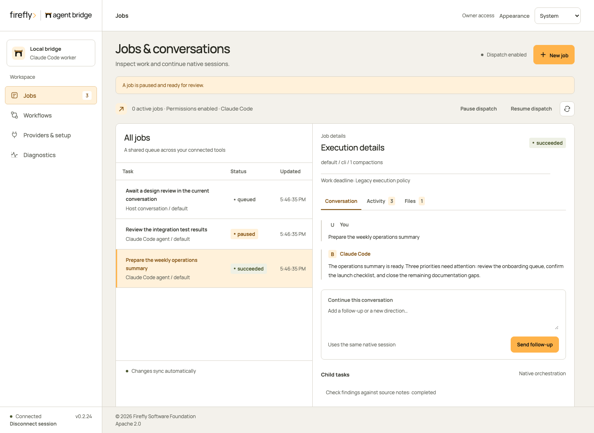

**New job** opens three steps: Task, Execution and Review. Describe the work, choose an existing profile and execution mode, then review the actual worker, native model, permissions and limits. Back preserves your choices. Queue job appears only on the review step.

Native coding jobs use the official CLI's configured capabilities. Text completions disable native actions; application callers execute declared functions. Host conversations wait for a connected host to claim the work. A failed or unknown admission keeps the request key when you queue unchanged content again.

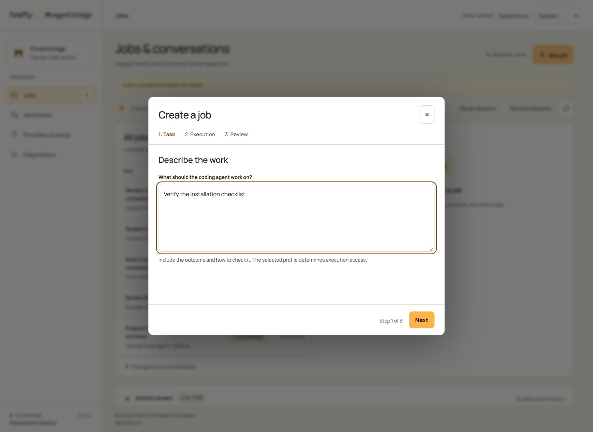

Pause, resume, cancel, and retry follow the job state and your token scopes. Image jobs require a fresh explicit request after interruption; their view does not offer in-place resume or retry. Retry is explicitly different from resume: it starts a new session and can repeat prior effects.

## Tool activity, files, and audit

Each job has **Conversation**, **Activity**, and **Files** tabs. Activity exposes complete emitted tool inputs and outputs, including shell commands and stdout/stderr. Files exposes known targets, returned or submitted content, and available before/after edit fragments. Expand **Raw input, result, and correlation** for the underlying observation.

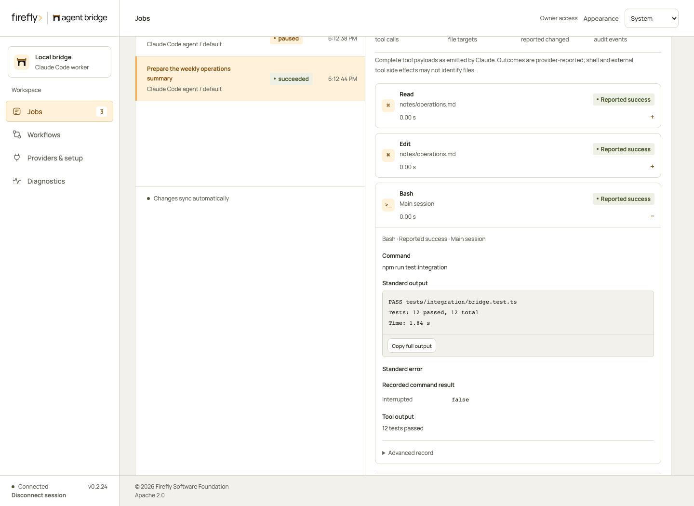

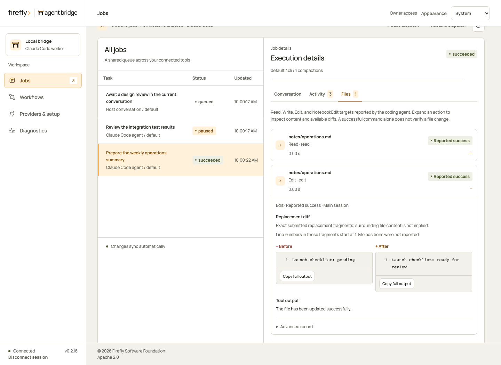

The audit log retains tool and lifecycle observations across service restarts and SSE retention. **Export audit** downloads a consistent JSON snapshot, including full payloads. Failed or interrupted actions remain clearly labeled; the console does not claim to observe every indirect filesystem effect. See [audit coverage, access, and export](audit.md).

[Mobile activity](../assets/screenshots/activity-mobile.png) · [Mobile file details](../assets/screenshots/files-mobile.png)

## Chat Completions

SDK requests and console-created completions appear in the same queue. Select one to inspect its submitted message history, validated answer or client function requests, observed token usage, and execution attempts. The inference view hides native follow-up controls because the calling application supplies complete history for its next model turn.

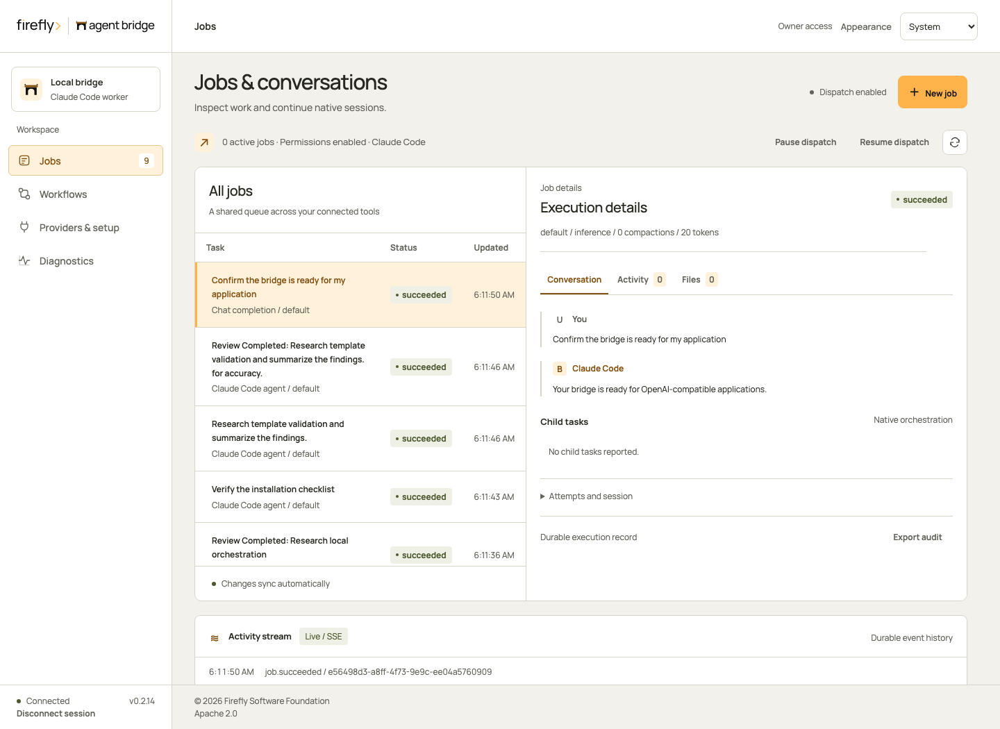

[Mobile completion view](../assets/screenshots/completion-mobile.png)

## Workflows

Choose a configured template, fill its named inputs, and start a run. JSON is available only under Advanced input when you explicitly select Use JSON values. Each run shows its current state and links to the jobs created for its steps. **Open step** switches directly to that job's conversation.

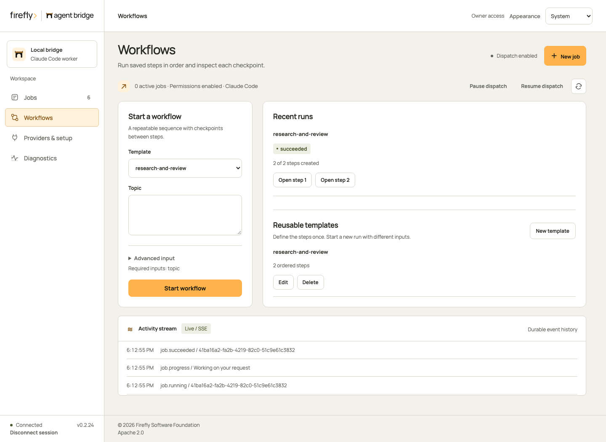

A failed or unknown admission retains its request key when you start again with unchanged inputs. It returns the existing run instead of repeating admitted work.

A workflow pause blocks the next step and requests a pause of its current job. Resuming the workflow clears that barrier. A failed step can be retried from its job view after reviewing its effects.

## Reusable template editor

Use **New template** to define inputs, ordered steps, instructions, and execution profiles. **Edit** updates future runs; existing runs keep their original definition. The form checks references before saving. See [template authoring](workflows.md) for valid use cases and rules.

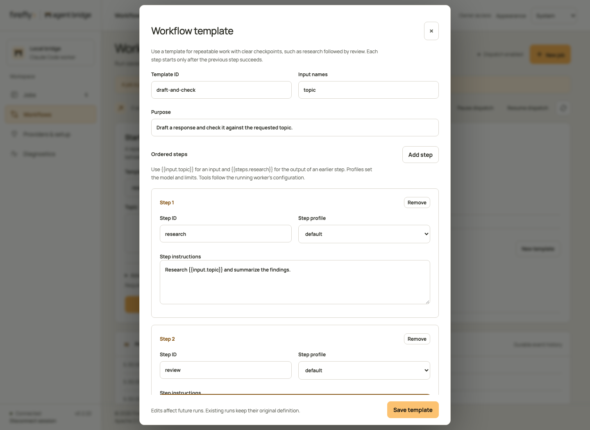

[Mobile template editor](../assets/screenshots/template-editor-mobile.png)

## Diagnostics and application access

Service health explains login readiness, dispatch state, active jobs, connected hosts, profiles, OpenAI base URL, model aliases, and the workspace. Expand **Connection and execution details** for the full status payload. Readiness combines official CLI login checks and the dispatch gate. A paused bridge can require attention while the provider remains signed in. Readiness does not establish that every configured model can complete a job.

Create a separate token for each trusted application. Choose Jobs and conversations, Read-only inspection, or Jobs and workflows. New tokens start masked; Show and Copy token are explicit actions. Revocation immediately invalidates requests and active event streams. Read-only access hides submission, continuation, administration and image-probe actions.

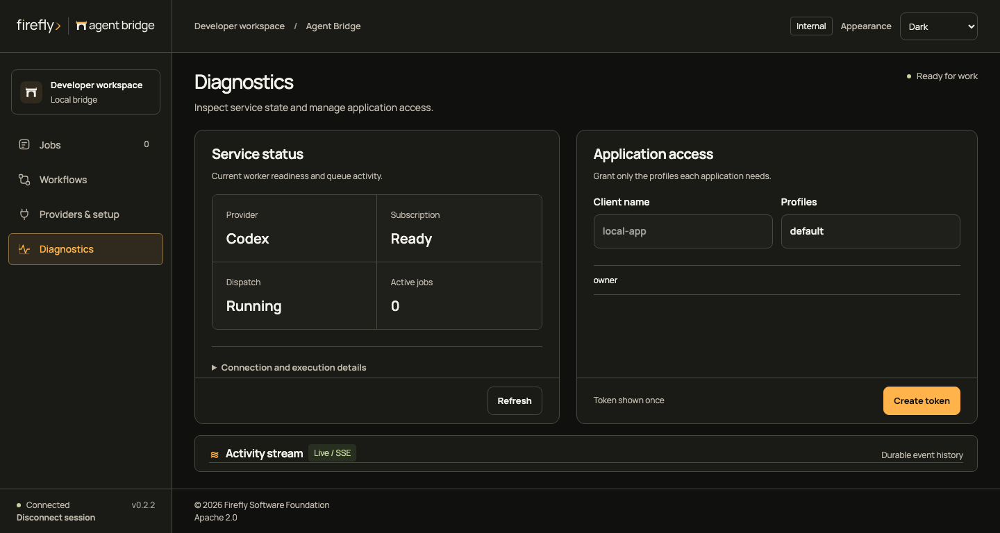

[Mobile service status](../assets/screenshots/diagnostics-mobile.png) · [Mobile application access](../assets/screenshots/diagnostics-access-mobile.png)

## Responsive navigation

Phones use a 60-pixel brand row and a 60-pixel context row. **Menu** opens a native modal with full navigation rows. Escape returns focus to Menu; selecting a destination closes it and focuses the heading. Resizing to desktop restores the sidebar and closes the dialog.

At narrower widths, select a job to open its details. **Back to jobs** returns to the queue and stays there during polling. Provider setup and Diagnostics use the page scroller, so short screens retain complete fields and readable status. Their action rows follow the content and never cover it. Diagnostics uses Service and Application access tabs on phones. On phones, **Actions ↓** appears in the context bar when setup or workflow controls are below the visible content. It scrolls to those controls and focuses them without advancing or submitting. Scroll normally to inspect the intervening fields; the global footer remains in its own row. Desktop uses an aligned 64-pixel status and legal footer; the phone footer occupies a separate 44-pixel row with safe-area padding.

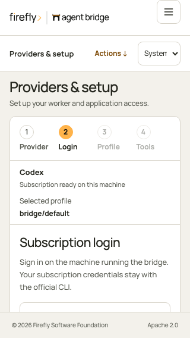

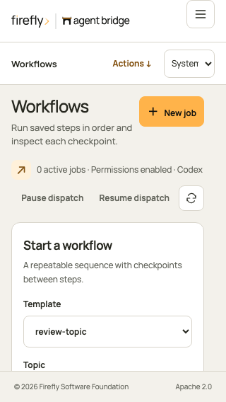

| Mobile jobs                                                | Mobile workflows                                                |
| ---------------------------------------------------------- | --------------------------------------------------------------- |
| 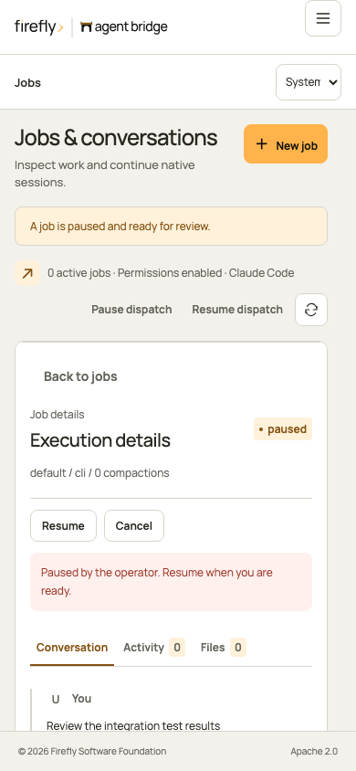 | 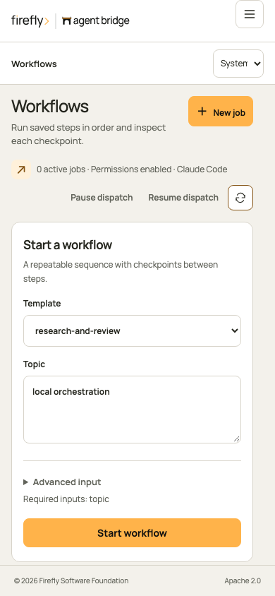 |

[Tablet jobs](../assets/screenshots/jobs-tablet.png) · [Tablet workflows](../assets/screenshots/workflows-tablet.png) · [Mobile diagnostics](../assets/screenshots/diagnostics-mobile.png)

## Live activity

The activity stream receives authenticated SSE events and reconnects with the last event ID. When retention has removed older events, it refreshes current job state before reconnecting. Tokens stay in tab memory and are never placed in a URL or browser local storage.

## Appearance and provider setup

Appearance follows the system by default. Choose Light or Dark to save an explicit preference on this browser. The console stores only that preference; reloading clears authentication. The fixed 76-pixel header, 248-pixel desktop rail, Manrope typography, and amber controls match the Firefly developer suite. Mobile navigation preserves access to every view.

Providers & setup guides you through four focused steps:

1. **Provider:** choose a Codex or Claude Code setup guide. The current running worker stays visible; selecting another guide does not change it.
2. **Login:** copy the official login command, run it on the bridge host, then refresh the running worker's readiness. Provider credentials are never entered in this form.
3. **Profile:** choose an existing profile and inspect its effective model, permissions, timeout and output bounds. Image input has a separate verification status. An owner can run one explicit image-only check and inspect its durable job; unverified or failed checks do not block ordinary text jobs.
4. **Tools:** select your application and follow its connection instructions. Codex and Claude plugins use the local stdio adapter. HTTP applications use a scoped bearer token. ChatGPT requires a reachable HTTPS gateway and authentication supported by its workspace; this console does not establish that connection.

The wizard keeps your selected profile when you move back between steps. Earlier visited steps remain accessible. **Start a job** opens the normal job dialog with that profile; it does not submit work automatically.

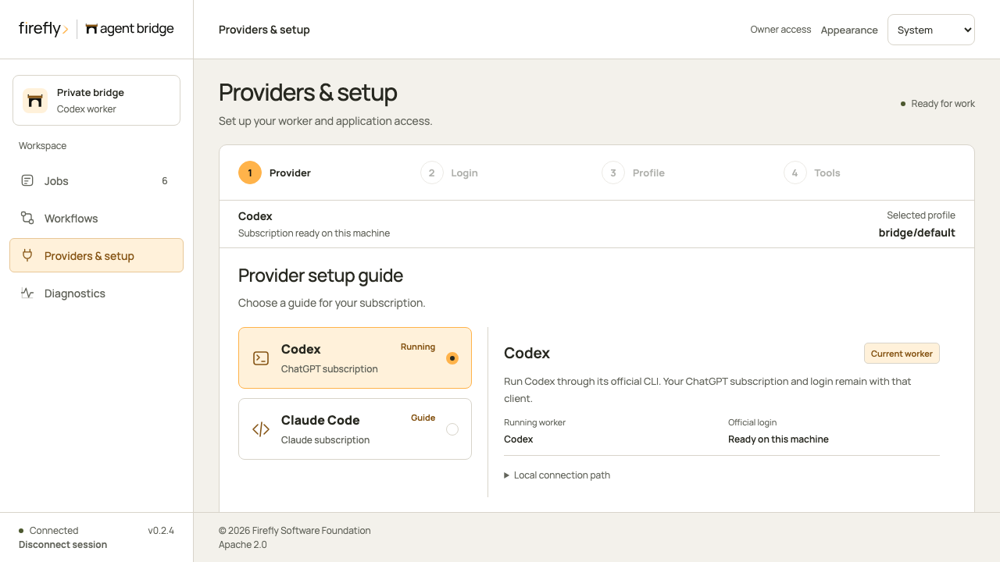

Change worker and profile configuration in the saved file while stopped, restart, then check the effective settings here. The console does not accept provider credentials or rewrite executable paths. Claude tool and agent definitions apply to Claude execution; they do not imply restrictions on Codex.
