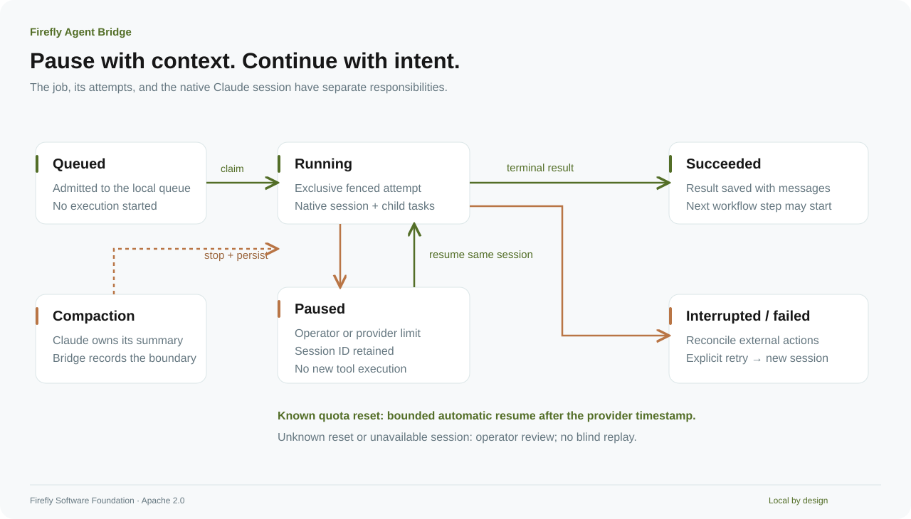

<!-- Copyright (c) 2026 Signature Management Consultants SLU; Author: @ancongui. Modified by Firefly Software Foundation for Firefly Agent Bridge (2026). SPDX-License-Identifier: Apache-2.0. -->

# Execution, recovery, and operations

!!! warning "For local development and testing"

    Firefly Agent Bridge is intended for local development and testing. It uses your signed-in coding CLI subscription rather than a separately billed model API; subscription quotas still apply. We advise against using it for production workloads: provider license and usage restrictions, local security boundaries, and performance limits may make it unsuitable. Check the terms of your plan and provider before connecting an application. See [OpenAI's terms](https://openai.com/policies/terms-of-use/) and [Anthropic's consumer terms](https://www.anthropic.com/legal/consumer-terms).

[README](../README.md) · [Architecture](architecture.md) · [Configuration](configuration.md)

[PNG version](../assets/diagrams/lifecycle.png)

## State and controls

| State              | Meaning                                      | Appropriate next action                              |
| ------------------ | -------------------------------------------- | ---------------------------------------------------- |
| `queued`           | Admitted, awaiting a worker or channel claim | Wait, pause, or cancel                               |
| `running`          | An exclusive attempt owns the work           | Inspect progress, send a follow-up, pause, or cancel |
| `pause_requested`  | The owner is being asked to stop             | Wait for the attempt to reconcile                    |
| `paused`           | No active attempt is executing the job       | Inspect the reason; resume when eligible             |
| `cancel_requested` | Cancellation is in progress                  | Wait for acknowledgment or reconciliation            |
| `succeeded`        | A terminal result was committed              | Read it or send a standalone follow-up               |
| `failed`           | Execution or validation failed               | Diagnose before an explicit retry                    |
| `timed_out`        | The configured attempt timeout elapsed       | Inspect partial side effects before retrying         |
| `canceled`         | The attempt acknowledged cancellation        | Retry only if intended                               |
| `interrupted`      | Worker or host ownership was lost            | Reconcile effects before retrying                    |

**Pause dispatch** stops new admissions to workers and requests pauses for active CLI jobs. It does not cancel the queue. **Resume dispatch** clears the global gate when the provider reset permits it; individual paused jobs remain explicit controls in the panel.

## Authentication, quota and dispatch

A successful CLI login check confirms that you are signed in. It cannot confirm available subscription allowance. The console separates that observation from the local dispatch gate and the last reported quota limit. With no quota observation, it says **quota not reported**. Neither Claude's `auth status` nor the current Codex `exec --json` adapter provides a current account allowance here. Bridge does not make an inference call to test availability or switch to paid API billing.

A quota rejection is retained with its provider, source and observation time. Switching from Claude to Codex, or the reverse, does not attribute the old provider's limit to the new one. An older record without provider identity stays explicitly unknown; the global dispatch gate still applies. Refreshing authentication, restarting Bridge or explicitly resuming dispatch does not erase that fact. **Last reported quota limit** shows the retained observation; individual provider buckets may since have changed. A reported reset remains a reported time after it passes; it does not prove allowance returned. Unknown reset times stay unknown. The scheduler's bounded continuation policy below remains separate from quota observation.

**Dispatch enabled** means the local gate permits a worker attempt. Its authentication check and the provider can still refuse it. The compatibility `readiness.ready` boolean is not a quota signal; use the separate observations described in the [API reference](api.md#provider-observations).

## Compaction

The selected CLI owns its native session. Claude owns the native transcript and its compacted summary. The bridge persists session IDs and records `job.compaction` events. A compacted conversation continues through Claude's `--resume` mechanism; the bridge does not replay the pre-compaction transcript.

Compaction reduces the conversation context sent to the model; it does not replenish subscription allowance and can itself consume tokens. Bridge reports native compaction events and leaves unreported context capacity and remaining token allowance unknown. Terminal token usage is not a measurement of the current context window. Consult the [official Claude Code cost and context guidance](https://code.claude.com/docs/en/costs).

Native session continuity is separate from semantic knowledge or memory. Bridge retains session references and observations; it does not promise that a compacted summary preserved every fact. A caller's Flycanon retrieval, citations and durable task evidence remain separate responsibilities.

A reported compaction failure pauses the execution for review. If a native session has been removed or is no longer resumable, the CLI reports an error. The bridge does not silently substitute a fresh session.

When Claude reports the structured terminal reason `prompt_too_long`, Bridge pauses that job with `context_exhausted` and keeps its session and activity history. It does not treat this as account quota exhaustion or automatically retry the job. Inspect the native session and its context before explicitly resuming the job. A context pause or failed compaction survives a Bridge restart; resumption uses the original session without replaying its earlier prompt. This recovery does not establish the current window size or remaining allowance.

## Subscription limits

The Claude adapter observes native `rate_limit_event` records; both workers handle recognized terminal quota errors. A rejection pauses the affected job and latches a persistent global dispatch gate.

A valid future `resetsAt` timestamp is honored with a five-second buffer. At that point the bridge can continue a quota-paused job with a saved session, up to three automatic resumptions per job. It never guesses a reset time from prose, purchases usage, changes subscriptions, or switches to API billing.

If a reset timestamp is absent, an operator must decide when to resume dispatch and the paused job. A workflow explicitly paused by an operator is not automatically resumed by the quota timer. Other attempts paused while a quota gate is applied remain visible for operator control.

Usage fields are shown only when reported by the selected provider. Missing utilization does not mean zero usage.

## Follow-up turns

A standalone job is a conversation. A follow-up received during execution waits for the current attempt to finish. On success, the next attempt uses the same session and only the new user messages. A paused attempt retains queued follow-ups until its unfinished work has been resumed and completed.

The bridge limits a conversation to 64 messages and 200,000 characters of retained conversation text when admitting another follow-up. Start a new job when that limit is reached.

Workflow prompts come from the snapshot. They do not accept arbitrary follow-up messages that would change the meaning of downstream steps.

## Crashes and external effects

At startup, recovery marks attempts that lost ownership as interrupted and retains them for inspection. Retrying that work requires an operator's decision. Attempt fences reject stale completion messages.

Database atomicity is not an exactly-once guarantee for external effects. A tool may have written a file, sent a request, or changed a remote system before its result was lost. Review the workspace and external state before retrying.

Inspect the job's **Activity** and **Files** tabs before retrying. Tool results, full payloads, and known file targets remain in the [durable audit](audit.md). A missing result is **Outcome unknown**, even if the tool may have completed its side effect.

## Host lifecycle

MCP adapters renew host leases every two seconds. A channel claim whose host lease expires is interrupted. A notification does not claim work and never completes a job by itself.

The managed service stays available while hosts or queued/active CLI work need it. Once that work ends and hosts disconnect, its idle timeout applies. The console also renews an owner host lease while connected. Run the portable CLI's `serve` command without `--managed` for a continuously available local service.

Use `stop` for graceful shutdown. Active CLI work is paused and child processes are reconciled before the database lock is released.

## Data, retention, and backups

The data directory contains `config.json`, `queue.sqlite`, `owner.token`, a discovery file, and service logs. Job workspaces are under the configured workspace directory. Native transcripts remain in the selected CLI's own storage.

The service retains the latest 10,000 event sequence IDs. Jobs, messages, attempts, workflow snapshots, and full execution audits remain durable. Monitor disk usage and archive data deliberately; this release does not silently delete job history.

Stop the service before making a filesystem backup of SQLite and its sidecars. Protect backups as user data: prompts, results, full file contents, shell commands/output, and bridge authentication material can be sensitive. To restore, keep the configuration's absolute paths consistent with the restored data directory.

### Make and verify a local backup

Use the same `--data-dir` as the running instance on every CLI command. `status` confirms which service is available; `panel` locates its console and owner-token file without printing the token.

1. Stop managed hosts and close connected consoles so they do not restart or keep the service alive. Request graceful shutdown with `bridge stop --data-dir /absolute/path/to/state` and wait for that instance to exit.
2. Copy the stopped data directory and configured job workspace to private backup storage. Include `queue.sqlite` and any remaining `queue.sqlite-wal` and `queue.sqlite-shm` sidecars together. SQLite uses WAL mode; copying only its main file during execution can omit committed observations.
3. Retain the matching configuration, owner token and workspace paths. Native coding-agent transcripts and subscription login belong to the official CLI's separate storage and need that provider's own recovery procedure.
4. Restore to a separate local test location while the original instance stays stopped. Review the copied `config.json` so its data and workspace paths identify only the restored test directories. Do not start two services against the same queue or job workspace.
5. Start the restored service explicitly, then inspect status, jobs, attempts, workflow snapshots and a known audit export. Startup can mark lost attempts interrupted; inspect their effects before retrying. Check the recovered files separately from the database history.

`service.log` records managed-service startup and process diagnostics. The job audit contains emitted execution observations. Neither log replaces a missing native transcript, a command result or a backup of source files. A restored owner token retains its authority; protect it and use the normal token controls when application access must be replaced.

## Native protocol references

The worker follows the official [programmatic CLI documentation](https://code.claude.com/docs/en/headless), [Agent SDK reference](https://platform.claude.com/docs/en/agent-sdk/typescript), and [channel protocol](https://code.claude.com/docs/en/channels-reference). Subscription support is described in [Anthropic's Claude-plan guidance](https://support.claude.com/en/articles/15036540-use-the-claude-agent-sdk-with-your-claude-plan).
