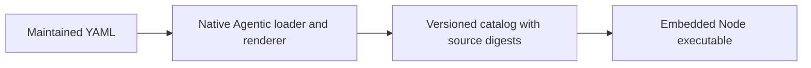

<!-- Copyright 2026 Firefly Software Foundation. SPDX-License-Identifier: Apache-2.0 -->

# Maintain internal prompts

The bridge keeps its internal model instructions in `resources/prompts/v1/`. Each YAML file uses the native `fireflyframework-agentic` prompt schema. Python renders those resources during authoring and verification; the installed bridge reads the resulting catalog with Node and needs no Python interpreter.

## Find the instruction

| Directory     | Responsibility                                                  |
| ------------- | --------------------------------------------------------------- |
| `completion/` | Completion envelope, conversation heading and image framing     |
| `workers/`    | Interrupted-turn continuation and quoted conversation context   |
| `mcp/`        | Host instructions, queued-work notifications and panel guidance |
| `tools/`      | Descriptions of the registered MCP operations                   |

The native YAML fields are `name`, `version`, `description`, `required_variables`, `system_template`, `user_template` and `metadata`. The resource name matches its path within `v1`. Metadata selects the consumed native output field. The current embedded catalog contains static instructions, so required variables are empty and dynamic Jinja expressions are refused.

Image dimensions, serialized conversation messages and user text remain runtime data. Their values are never compiled as templates. Image framing uses maintained prefix and suffix resources around the validated image metadata. Message roles, ordering and function-call validation remain in the protocol adapter.

## Change and verify a prompt

Use a Python 3.13 build environment containing the pinned dependency in `scripts/prompts-requirements.txt`. Set `BRIDGE_PYTHON` to that interpreter, as for the other Python build checks. This dependency is for maintainers and CI.

1. Edit the appropriate YAML resource. Preserve message priority and continuation behavior unless the change deliberately revises that contract.
2. Run `npm run prompts:render`. The generator uses the native `PromptLoader`, `PromptRegistry` and `PromptTemplate.render` APIs with an explicit version.
3. Review the YAML and generated `resources/prompts/catalog.json` together. Each catalog entry records its source path, version, source digest, rendered text and text digest.
4. Run `npm run prompts:check` and the complete `npm run check` gate. Review the byte-exact baseline fixture when intentionally changing behavior; do not update it merely to dismiss a failure.

The generator rejects duplicate YAML keys, unexpected fields, mismatched identities or versions, runtime variables and unused output text. The build checks registered source paths and digests before bundling. Runtime catalog validation checks its structure, rendered-text digests and overall catalog digest. These checks detect stale or malformed resources; they are not a signature or proof that a model followed an instruction.

The existing `.gitattributes` keeps text files at LF on every supported build host, so source digests remain consistent across operating systems. Do not edit the generated catalog by hand or introduce a second template interpreter in the Node runtime.

## User-owned workflows and profiles

Configured job prompts, profile-defined agents and workflow steps remain operator-owned data. Workflow expressions such as `{{input.name}}` and `{{steps.review}}` keep their existing workflow syntax; they are not Jinja templates. Existing runs retain their original snapshots. Changing an internal resource does not rewrite queued work, retained messages or provider transcripts.

The catalog records packaged instruction provenance. It does not introduce per-turn prompt receipts, grant additional tools or change provider permissions. See [workflows](workflows.md), [agent profiles](subagents.md) and [architecture](architecture.md) for those separate contracts.
